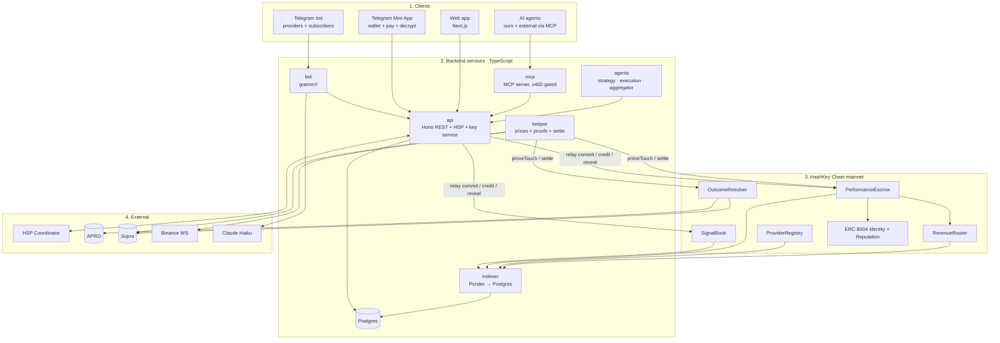

# 1. How the product works, end to end

## 1.1 The four layers

**Rule of thumb:**
- **Chain** = source of truth for money, commitments and outcomes.
- **Postgres** = fast read copy (from the indexer) + off-chain data (ciphertexts, sessions, Telegram IDs, agent policies).
- **API** = the only thing that writes to chain on users' behalf (sponsored relayer) and the only thing that talks to HSP.
- **Frontend never holds secrets.** Users sign with their own wallet (WalletConnect / Reown); the API relays.

## 1.2 Flow A: provider posts a signal
1. Provider writes `BTC LONG entry 81500 TP 84000 SL 80200 24h` in their channel (bot is admin).
2. **bot** sees the post → **parser**: Cornix rules, else Claude Haiku with a JSON schema.
3. bot DMs the provider: parsed fields + **Confirm** button. Confirm opens the Mini App, which asks the provider's wallet to sign the EIP-712 `Signal` struct.
4. **api** generates a random salt and an AES-256-GCM key, encrypts the signal text, stores ciphertext in Postgres, computes `commitHash`.
5. **api** (relayer wallet, pays gas) calls `SignalBook.commit(...)` with the provider's signature.
6. **indexer** picks up `SignalCommitted`; the web and bot show a "locked" card with a Blockscout link.

## 1.3 Flow B: subscriber buys a signal (human)
1. Subscriber taps **Buy** under the locked card in Telegram → Mini App `/tg/buy/:id`.
2. Mini App connects wallet (Reown AppKit), shows price, provider score and "refund if wrong".
3. Mini App calls `POST /purchases` → api returns an HSP payment intent (Mandate with `payee = escrow`, `reference = keccak(signalId, subscriber)`).
4. Wallet signs the Mandate and sends the USDT/USDC.e transfer to `PerformanceEscrow` (HSP `eip1193` signer).
5. api asks the Coordinator to observe, gets the Receipt, runs `HSPVerifier.verify()` locally.
6. On **ACCEPT**, api calls `PerformanceEscrow.creditPayment(...)`.
7. **key service** wraps the AES key with ECIES to the subscriber's public key; bot DMs it; Mini App decrypts and shows the signal.

## 1.4 Flow C: agent buys a signal
Same as B, but the execution agent uses `@hsp/mcp` (`hsp_pay` under SpendGuard) or `HSPClient.pay()` with its AgentKit wallet, after checking its user's policy (budget, min score, markets). Optional: trade on HSKSwap and record the fill.

## 1.5 Flow D: settlement
1. **keeper** watches Binance WebSocket prices for every live signal.
2. When TP or SL is crossed, it fetches a **Supra pull proof** and calls `OutcomeResolver.proveTouch(signalId, level, proof)`.
3. A challenge window runs (10 min). Anyone can submit an earlier touch of the other level.
4. If no touch by `validUntil`, keeper calls `resolveAtExpiry` using the **APRO** price.
5. keeper calls `PerformanceEscrow.settle(signalId)`:
   - **WIN** → provider paid (minus 10% fee), via `RevenueRouter` if there are upstream signals.
   - **LOSS** → every subscriber refunded + slice of the provider's bond.
6. Escrow writes ERC-8004 reputation feedback.
7. api calls `SignalBook.reveal(...)` with plaintext + salt. If nobody reveals in time, anyone can call `markUnrevealed` → automatic loss.
8. indexer updates; scoring recomputes; bot posts the graded card to the channel.

## 1.6 Flow E: aggregator (A2A, multi-hop)
1. Aggregator agent buys top-N signals for BTC (Flow C).
2. Blends them into a meta-signal; commits with `upstream[]` and `upstreamBps[]`.
3. Others buy the meta-signal. On a WIN, `RevenueRouter` splits payout to upstream providers (depth cap 3).

## 1.7 What lives where
| Data | Where | Why |
|---|---|---|
| Commit hash, timestamp, market, expiry, price | Chain (`SignalBook`) | Must be unforgeable |
| Ciphertext of the signal | Postgres (IPFS later) | Only the hash needs to be on-chain |
| Payments, bonds, payouts | Chain (`PerformanceEscrow`, `ProviderRegistry`) | Money |
| Outcome | Chain (`OutcomeResolver`) | Oracle-proven |
| Reputation | Chain (ERC-8004) | Portable |
| Scores (Wilson, expectancy, alpha) | Postgres (computed from chain) | Recomputable by anyone |
| Telegram IDs, sessions, agent policies, wrapped keys | Postgres | Private, off-chain |
