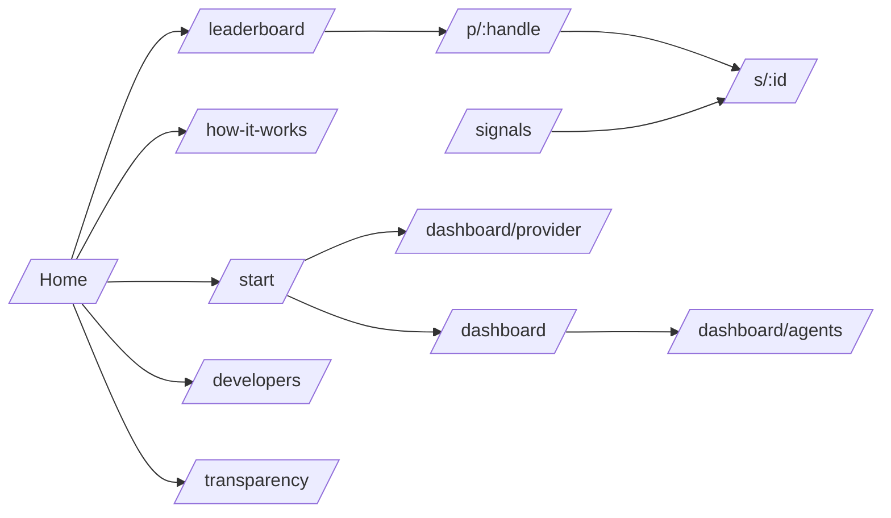

# 2. Frontend: every page we build

Three frontends share one design system and one API:
1. **Web app** (Next.js, `apps/web`): public trust surface + dashboards.
2. **Telegram Mini App**: the same Next.js app under `/tg/*`, opened inside Telegram for wallet actions.
3. **Telegram bot** (chat UI, `apps/bot`): where providers and subscribers already are.

## 2.1 Page map

## 2.2 Web pages (13)

| # | Route | Page | MVP? | Who it's for |
|---|---|---|---|---|
| 1 | `/` | **Home** | ✅ | Everyone, judges |
| 2 | `/leaderboard` | Leaderboard | ✅ | Subscribers |
| 3 | `/p/[handle]` | Provider profile | ✅ | Subscribers, providers sharing their badge |
| 4 | `/s/[id]` | Signal detail | ✅ | Everyone (linked from Telegram) |
| 5 | `/start` | Connect + choose role | ✅ | New users |
| 6 | `/dashboard/provider` | Provider dashboard | ✅ | Providers |
| 7 | `/dashboard` | Subscriber dashboard | ✅ | Subscribers |
| 8 | `/dashboard/agents` | Agent policy settings | Stretch | Subscribers delegating to an agent |
| 9 | `/signals` | Live signal feed / explorer | Stretch | Everyone |
| 10 | `/how-it-works` | How it works + trust rules | Stretch (can be a Home section first) | Skeptics, judges |
| 11 | `/developers` | MCP, API, contract addresses | Stretch | Agent builders, judges |
| 12 | `/transparency` | Live stats + contract addresses + HSP payment IDs | Stretch | Judges |
| 13 | `/legal` | Terms + disclaimer | ✅ (one static page) | Everyone |

Plus non-page routes: `/api/og/badge/[handle]` (badge image), `/api/og/signal/[id]` (graded card image for sharing).

### Page 1: Home `/`
**Goal:** in 10 seconds, "signals you can't fake, refund if wrong".
| Section | Content | Data |
|---|---|---|
| Hero | Headline "Pay only when the call is right", sub-line, buttons **See leaderboard** / **I'm a provider** | — |
| Live ticker | Last 10 settled signals: ✅/❌, market, R result, provider | `GET /signals?status=settled&limit=10` |
| How it works | 4 steps: Lock → Pay → Settle → Prove, each with an icon | static |
| Trust rules | 7 rule cards (refund, every call counts, skill not luck, bond, real follower results, pump-and-dump, no need to trust us) | static |
| Top providers | 3 cards from the leaderboard | `GET /providers?sort=score&limit=3` |
| Numbers | Signals committed, payments settled, refunds paid, providers | `GET /stats` |
| For agents | MCP one-liner + link to `/developers` | static |
| Footer | Contract links (Blockscout), GitHub, Telegram bot link, disclaimer | config |

### Page 2: Leaderboard `/leaderboard`
- Filters: market (BTC, HSK…), period (7d / 30d / all), type (human / agent / aggregator), verified only, include "observed" shadow profiles.
- Table columns: rank, provider (avatar, handle, ✓ KYC badge, 🤖 agent tag), **score**, Wilson win-rate lower bound, expectancy (R), alpha vs BTC, settled signals, follower PnL, price/signal, bond.
- Rows under 30 signals show "Probation" and don't get a rank.
- Data: `GET /providers?...`

### Page 3: Provider profile `/p/[handle]`
- Header: name, badges (Verified KYC, Trades own calls, Agent), ERC-8004 ID link, bond amount, **Copy badge** button.
- Score panel: score, Wilson bound, expectancy R, alpha vs BTC, max drawdown, sample size.
- Equity curve (cumulative R) chart.
- "Real follower results": followed count, watched count, average follower PnL after fees.
- Signal history table: time committed, market, side, result, R, Blockscout link. Locked (live) signals show 🔒 + **Buy**.
- Data: `GET /providers/:handle`, `GET /providers/:handle/signals`.

### Page 4: Signal detail `/s/[id]`
- **States:** Locked (live, unpaid) · Unlocked (you paid) · Settled WIN · Settled LOSS · Unrevealed (auto-loss).
- Price chart (lightweight-charts) with entry, TP, SL lines, commit time marker, touch marker.
- Proof box: commit tx, commit timestamp, commit hash, reveal tx, oracle proof tx, settlement tx, HSP payment IDs. Each links to Blockscout or HSP Explorer.
- Buy box (if live): price, "refund if wrong", provider capacity left, **Buy** button.
- Aggregator signals: upstream tree with weights and each upstream's result.
- Data: `GET /signals/:id`, `GET /prices?market=&from=&to=`.

### Page 5: Start `/start`
- Connect wallet (Reown AppKit, HashKey chain 177).
- Choose: **I post signals** → provider onboarding (link Telegram via bot deep link, register ERC-8004 identity, deposit bond) · **I buy signals** → subscriber dashboard.

### Page 6: Provider dashboard `/dashboard/provider`
- Onboarding checklist: wallet ✓ · Telegram channel linked ✓ · ERC-8004 identity ✓ · bond deposited ✓ · KYC attestation (optional).
- Bond card: deposited, locked in open signals, free, capacity per signal; **Deposit** / **Withdraw** (delayed).
- Signals: live / awaiting reveal (with **Reveal now** warning) / settled.
- Earnings: gross, fees, slashed, net; payouts list.
- Settings: default price per signal, default validity, pay-if-works on/off (locked until probation passes), practice profile toggle.
- Badge: embed code + image preview.

### Page 7: Subscriber dashboard `/dashboard`
- Active purchases: decrypted signal, live P/L vs entry, time left.
- History: result, paid, refunded, bond slice received.
- Totals: spent, refunded, net.
- Followed providers.
- Link to agent settings.

### Page 8: Agent settings `/dashboard/agents`
- Create execution agent (AgentKit wallet address shown; fund it).
- Policy: daily budget, per-signal cap, min provider score, allowed markets, allowed providers, auto-trade on HSKSwap on/off + slippage cap.
- Activity log: each purchase, HSP payment ID, policy check result.
- Pause / kill switch.

### Pages 9–13 (stretch)
- **`/signals`**: live feed of locked and recent settled signals, filters by market/status.
- **`/how-it-works`**: the full trust design, anti-gaming table, FAQ.
- **`/developers`**: MCP install snippet, tool list, REST API reference, contract addresses + ABIs, EIP-712 types.
- **`/transparency`**: totals, every contract address, last 50 HSP payment IDs, keeper health.
- **`/legal`**: "verification infrastructure, not investment advice".

## 2.3 Telegram Mini App screens (4)
Opened from bot buttons, inside Telegram, same Next.js app.
| Route | Screen | What it does |
|---|---|---|
| `/tg/connect` | Connect wallet | Reown AppKit → links wallet to Telegram user |
| `/tg/confirm/[draftId]` | Provider confirm | Shows parsed signal, provider signs the EIP-712 struct |
| `/tg/buy/[id]` | Buy signal | Price, provider score, refund promise → HSP pay from wallet |
| `/tg/my` | My signals | Decrypt and view purchased signals, results, refunds |

## 2.4 Telegram bot commands (9)
| Command | Who | Action |
|---|---|---|
| `/start` | All | Welcome, choose role, deep links |
| `/connect` | All | Opens `/tg/connect` |
| `/link_channel` | Provider | Instructions to add bot as channel admin; verifies |
| `/bond` | Provider | Shows bond; link to dashboard to deposit |
| `/signals` | All | Live signals from followed providers |
| `/buy <id>` | Subscriber | Opens `/tg/buy/:id` |
| `/my` | Subscriber | Opens `/tg/my` |
| `/agent` | Subscriber | Shows agent status, pause/resume |
| `/help` | All | Trust rules + disclaimer |

**Automatic bot messages:** confirm-to-commit DM to provider · locked card posted under the signal in channel (with Buy button) · key delivery DM to buyer · result card (✅/❌) after settlement · reveal reminder to provider.

## 2.5 Frontend tech
Next.js (App Router) · Tailwind · shadcn/ui · lightweight-charts · Reown AppKit + wagmi + viem · TanStack Query · `@telegram-apps/sdk-react` for the Mini App · `@vercel/og` for badge images. Details in [06-sdks-and-packages.md](06-sdks-and-packages.md).
