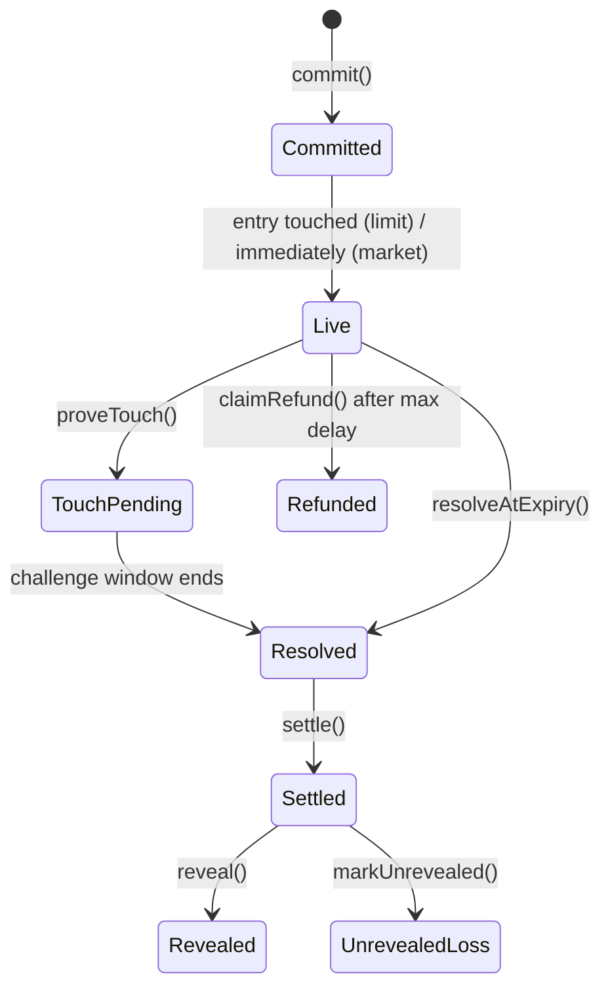

# 4. Smart contracts

Solidity 0.8.x · Foundry · OpenZeppelin · HashKey mainnet (chainId 177) + testnet. Full reasoning in [`Idea/05-architecture.md`](../Idea/05-architecture.md); this file is the interface-level spec.

## 4.1 Contract list
| Contract | Depends on | Size |
|---|---|---|
| `ProviderRegistry` | ERC-8004 Identity | S |
| `SignalBook` | ProviderRegistry, OutcomeResolver (entry price check) | M |
| `OutcomeResolver` + `AproPushAdapter` + `SupraPullAdapter` | APRO, Supra | M |
| `PerformanceEscrow` | SignalBook, OutcomeResolver, ProviderRegistry, RevenueRouter, ERC-8004 Reputation | L |
| `RevenueRouter` | SignalBook | S |
| ERC-8004 `IdentityRegistry` + `ReputationRegistry` | reference code | S (deploy) |

## 4.2 Signal state machine


## 4.3 Interfaces

### `ProviderRegistry`
```solidity
function register(uint256 agentId8004, address payout, bytes32 tgHandleHash) external;
function depositBond(address token, uint256 amount) external;
function requestBondWithdraw(uint256 amount) external;   // starts delay
function withdrawBond() external;                         // after delay, no open signals
function setKycAttestation(bytes calldata att, bytes calldata issuerSig) external;
function capacity(address provider, uint256 slashPerSub) external view returns (uint256);
function lockBond(address provider, uint256 amount) external;   // only SignalBook/Escrow
function slash(address provider, address to, uint256 amount) external; // only Escrow
event ProviderRegistered(address indexed provider, uint256 agentId);
event BondDeposited(address indexed provider, address token, uint256 amount);
event BondSlashed(address indexed provider, address indexed to, uint256 amount);
event KycSet(address indexed provider, uint64 until);
```

### `SignalBook`
```solidity
struct Signal { address provider; bytes32 market; uint8 side; uint256 entry; uint256 takeProfit;
  uint256 stopLoss; uint64 validUntil; uint256 pricePerSub; uint256[] upstream;
  uint16[] upstreamBps; bytes32 salt; }

function commit(bytes32 commitHash, bytes32 market, uint64 validUntil, uint256 pricePerSub,
  string calldata cipherURI, uint256[] calldata upstream, uint16[] calldata upstreamBps,
  bytes calldata providerSig) external returns (uint256 signalId);   // relayer pays gas
function reveal(uint256 signalId, Signal calldata s) external;      // hash must match; R:R ≥ 1
function markUnrevealed(uint256 signalId) external;                 // anyone, after window
event SignalCommitted(uint256 indexed id, address indexed provider, bytes32 market, uint64 validUntil, uint256 price);
event SignalRevealed(uint256 indexed id, Signal s);
event SignalUnrevealed(uint256 indexed id);
```

### `OutcomeResolver`
```solidity
enum Outcome { NONE, WIN, LOSS }
function proveTouch(uint256 signalId, uint8 level, bytes calldata supraProof) external;
function challenge(uint256 signalId, uint8 level, bytes calldata earlierProof) external;
function resolveAtExpiry(uint256 signalId) external;     // APRO price, 0.5R rule
function outcomeOf(uint256 signalId) external view returns (Outcome, int256 rMultipleX100, bool final_);
event TouchProven(uint256 indexed id, uint8 level, uint256 price, uint64 ts);
event Resolved(uint256 indexed id, Outcome outcome, int256 rX100);
```
Note: TP/SL are hidden until reveal, so `proveTouch` and `resolveAtExpiry` also take the plaintext `Signal` and reveal it in the same transaction (checked against `commitHash`). Resolution doubles as reveal. Limit signals add an `ENTRY` level, and a limit signal whose entry never touches resolves as `VOID` (refund, no slash). Details in `Prompts/03`.

### `PerformanceEscrow`
```solidity
function creditPayment(uint256 signalId, address subscriber, uint256 amount,
  bytes32 receiptHash, bytes calldata adapterSig) external;          // HSP path
function fundWithAuthorization(uint256 signalId, /* EIP-3009 fields */) external; // fast path
function settle(uint256 signalId) external;                          // anyone
function claimRefund(uint256 signalId) external;                     // anyone, after max delay
event PaymentCredited(uint256 indexed id, address indexed sub, uint256 amount, bytes32 receiptHash);
event Settled(uint256 indexed id, uint8 outcome, uint256 payout, uint256 refunds, uint256 slashed);
event Refunded(uint256 indexed id, address indexed sub, uint256 amount);
```
Invariants (fuzz/invariant tests): `totalCredited[token] ≤ balanceReceived[token]` · each `receiptHash` used once · funds never stuck (claimRefund always possible after delay).

### `RevenueRouter`
```solidity
function route(uint256 signalId, address token, uint256 amount) external; // only Escrow; depth ≤ 3
event Routed(uint256 indexed id, uint256 indexed upstreamId, address to, uint256 amount);
```

## 4.4 Parameters (initial)
| Param | Value |
|---|---|
| Protocol fee | 10% of winning payments |
| Reveal window | 6 h after settlement |
| Challenge window | 10 min |
| Max settle delay | 24 h after `validUntil` |
| Min R:R | 1:1 |
| Expiry rule | WIN if move ≥ 0.5R in signal direction |
| Slash per subscriber | ≥ price per signal |
| Bond withdraw delay | 7 days and no open signals |
| Per-signal cap (mainnet MVP) | small, e.g. $5 |

Admin: `Pausable` + `TimelockController` for fees/params only. No admin path to user funds.

## 4.5 Deployment order
1. ERC-8004 Identity → Reputation
2. ProviderRegistry
3. OutcomeResolver (+ adapters with APRO/Supra addresses)
4. SignalBook
5. RevenueRouter
6. PerformanceEscrow → grant roles (Registry slash, Reputation writer, Router caller)
7. Verify all on Blockscout; write addresses to `packages/shared/addresses.json`
