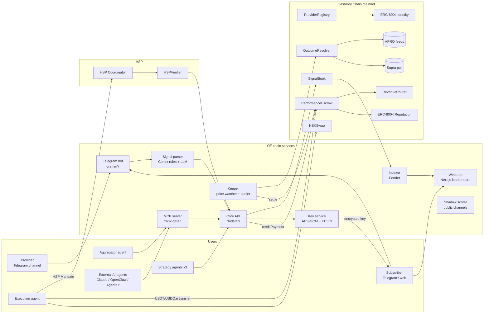
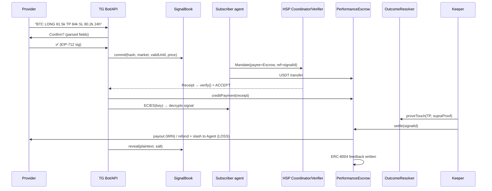

# 5. Product Architecture

## 5.1 System overview


## 5.2 Smart contracts (Solidity 0.8.x, Foundry, HashKey mainnet)

### `ProviderRegistry`
- `register(agentId8004, payoutAddr, telegramHandleHash)` links a provider to an ERC-8004 identity NFT. AI strategy agents register the same way, so humans and agents share one registry.
- `depositBond(token, amount)` / `withdrawBond()`. Withdrawals are delayed until open signals settle.
- `setKycAttestation(attestation, issuerSig)` checks the signature of the HSP KYC attestation against the allowlisted issuer key and stores `kycVerifiedUntil`.
- `capacity(provider, signalId) = freeBond / slashPerSubscriber`, the maximum number of paying subscribers for a signal.

### `SignalBook`
- Signal struct, hashed as EIP-712 typed data:
  ```
  Signal { provider, market (feed id), side (LONG/SHORT), entry, takeProfit, stopLoss,
           validUntil, pricePerSub, upstream[] (signalIds), upstreamBps[], salt }
  ```
- `commit(commitHash, market, validUntil, pricePerSub, cipherURI)` records `block.timestamp` and the entry price snapshot from the oracle, and emits `SignalCommitted`. It is called by the bot as a sponsored relayer, carrying the provider's EIP-712 signature, so providers need no gas.
- `reveal(signalId, Signal plaintext)` requires `hash(plaintext) == commitHash` and enforces a sane R:R (`|TP−entry| ≥ |entry−SL|`) for pay-if-works.
- `markUnrevealed(signalId)` is callable by anyone after `validUntil + revealWindow`. The signal becomes `LOSS_UNREVEALED`, the bond is slashed, and subscribers are refunded.
- The entry price is checked against the oracle at commit time. If the stated entry is more than X% away from the market, the signal becomes a "limit" signal that only goes live once the entry is touched. This stops providers from claiming fake entries.

### `PerformanceEscrow`
Holds subscriber payments per `(signalId, subscriber)`. There are **two funding paths**:
1. **HSP standard path (USDT or USDC.e):**
   - The subscriber or agent signs an HSP Mandate with `payee = escrow` and `reference = keccak(signalId, subscriber)`. Their wallet transfers the tokens, and the HSP Coordinator observes the transfer and issues a Receipt.
   - Our API runs `HSPVerifier.verify()`. On **ACCEPT** it calls `creditPayment(signalId, subscriber, amount, receiptHash, adapterSig)`.
   - The contract checks the receipt signature against the allowlisted HSP adapter key, rejects any receipt used twice, and enforces `totalCredited ≤ tokenBalanceReceived`. A credit can never exceed real tokens.
2. **Fast path (USDC.e, EIP-3009):** `fundWithAuthorization(signalId, auth)` calls USDC.e `receiveWithAuthorization` with a nonce equal to `keccak(signalId, subscriber)`. The payment is attributed atomically and gaslessly, x402-style.

Settlement:
- `settle(signalId)` reads the outcome from `OutcomeResolver`.
  - **WIN:** the provider gets `sum × (1 − fee)`, routed through `RevenueRouter` if the signal has upstream references. The protocol treasury gets the fee.
  - **LOSS:** each subscriber is refunded in full and receives `slashPerSubscriber` from the provider's bond.
- After settling, it writes feedback to the ERC-8004 Reputation Registry: score, R-multiple, and a pointer to the HSP receipt.
- `claimRefund(signalId)` is a permissionless fallback that refunds subscribers if settlement hasn't happened after `validUntil + maxSettleDelay`, so funds can never get stuck.

### `OutcomeResolver`
- **Adapters:** `AproPushAdapter` (Chainlink-style `latestRoundData` / `getRoundData`) and `SupraPullAdapter` (verifies a signed price proof with its timestamp).
- **Touch proofs:** anyone, usually our keeper, calls `proveTouch(signalId, level (TP|SL), proof)`. The contract verifies the proof's price and timestamp: the timestamp must be inside `[commitTime, validUntil]` and the price must have crossed the level.
- **Challenge window** (e.g. 10 minutes): a counter-proof showing the *other* level was touched **earlier** overrides the first one. The earliest valid touch wins.
- **No touch by expiry:** the outcome is marked to market at the expiry price from APRO push. It is a WIN if the move in the signal's direction is at least 0.5R, otherwise a LOSS.

### `RevenueRouter`
- When an aggregator's meta-signal wins, its payout is split by `upstreamBps` to the upstream providers. If an upstream signal lost, its share goes back to the subscribers or the aggregator, depending on the configured policy. This works recursively across multiple hops, with a depth cap of 3.

### ERC-8004 registries
- Deploy the reference **Identity** and **Reputation** registry contracts to HashKey mainnet. The canonical CREATE2 address is not yet used on chain 177, so try that address first and otherwise use a standard deployment.
- `PerformanceEscrow` is an authorized feedback writer, which makes reputation verifiable through the receipt each feedback entry links to.

## 5.3 Off-chain services
| Service | Job |
|---|---|
| **Telegram bot** | Joins a provider's channel as admin, detects signal posts, asks the provider to confirm with one tap, then relays the commit. For subscribers: `/buy`, `/portfolio`, `/agent` settings, and key delivery by direct message. |
| **Signal parser** | Rules for the Cornix-style format first. If those fail, an LLM (Claude Haiku 5.5) does structured extraction with a JSON schema. A human confirmation step comes before every commit. |
| **Key service** | Generates a fresh AES-256-GCM key per signal and stores the ciphertext (hash committed on-chain). After an HSP ACCEPT it wraps the key with ECIES to the subscriber's secp256k1 public key. At reveal, the plaintext and salt are published. |
| **Keeper** | Streams CEX prices (e.g. Binance WebSocket) to spot touches early. Fetches a Supra pull proof, calls `proveTouch`, then `settle`. Runs `markUnrevealed` and `claimRefund` sweeps. |
| **Indexer** | Ponder indexes all contract events into Postgres for the leaderboard, profiles and follower stats. |
| **Scoring engine** | Computes the Wilson lower bound, expectancy in R, alpha vs BTC, max drawdown and sample size. Open source, so anyone can recompute from chain data. |
| **Execution agent** | Runs under a per-user policy (budget, minimum score, markets). Uses HSP via `@hsp/mcp` with SpendGuard. Optionally swaps on HSKSwap with a slippage cap and records fills for "real follower PnL". |
| **Strategy agents** | Three simple open-source strategies (momentum, funding-rate, news-sentiment) that post signals through the same API, so the marketplace has supply from day one. |
| **Aggregator agent** | Buys top-N provider signals for a market and commits a meta-signal with upstream references and weights. |
| **MCP server** | Tools `list_providers`, `get_signals`, `verify_track_record`, `buy_signal`. Paid calls go through `x402Gate` / HSP. |
| **Shadow scorer** | Reads public channel pages (`t.me/s/<channel>`), parses the calls, and scores them against historical prices. Shown as "observed, not committed". Providers can opt out. |
| **Web app** | Leaderboard, provider profiles, a signal explorer linking to Blockscout, shareable badge images, and agent policy settings. |

## 5.4 Main sequence: buying a signal


## 5.5 Anti-gaming summary
| Attack | Defense |
|---|---|
| Delete or edit losing calls | Commit before the move; an unrevealed signal is an automatic loss |
| Post both sides on two accounts | Bond slash ≥ price makes coin-flip expected value negative; KYC and ERC-8004 identity cost |
| Tiny TP with a huge SL to farm win rate | Minimum 1:1 R:R; ranked by expectancy, not win rate |
| Fake entry price | Entry checked against the oracle at commit; otherwise it becomes a limit signal |
| Self-subscribing to inflate follower count | Follower stats weighted by unique KYC'd or bonded wallets; self-payments only cost fees |
| Pump-and-dump on followers | Liquid oracle markets only; wallet-link monitoring; challenge and slash |
| Lucky streak | Minimum 30 signals before ranking; Wilson lower bound |
| Rogue keeper or settlement | Proofs verified on-chain; challenge window; permissionless `claimRefund` |

## 5.6 Trust assumptions (stated openly)
- **The key service sees plaintext signals** before they're revealed. It handles confidentiality, never funds. A future version moves this to threshold encryption or a TEE.
- **HSP adapter and issuer keys** are trusted as defined by HSP's trust set.
- **Oracle correctness** comes from APRO and Supra.
- **Admin powers** are limited to pausing and fee changes under a timelock. There is no admin path to user funds.
