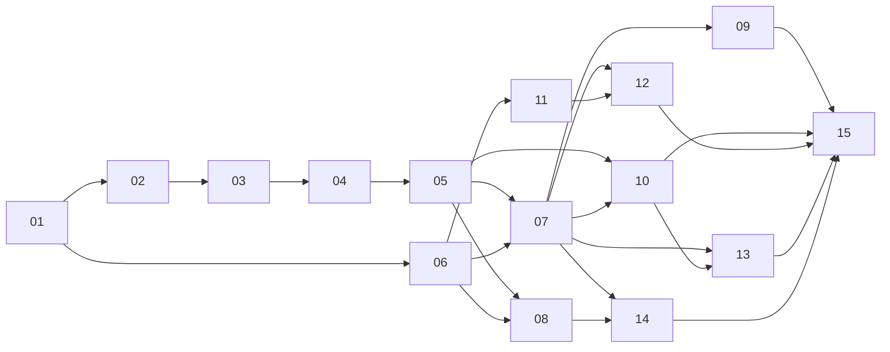

# Build prompts

15 prompts that build Nundina from an empty repo to a submitted hackathon entry. Run them **in order**, one per Claude Code session (or one per teammate where the dependency column allows it).

Each prompt is self-contained: paste the whole file content as the message. Every prompt tells the assistant to read the relevant docs in `Idea/` and `Architecture/` first, so the docs stay the source of truth.

## Order and dependencies

| # | Prompt | Builds | Depends on | Can run in parallel with |
|---|---|---|---|---|
| 01 | [01-monorepo-and-shared.md](01-monorepo-and-shared.md) | pnpm monorepo, `packages/shared` (EIP-712 types, chain config, scoring types) | — | — |
| 02 | [02-contracts-registry-signalbook.md](02-contracts-registry-signalbook.md) | ERC-8004 registries, `ProviderRegistry`, `SignalBook` | 01 | 06 |
| 03 | [03-contracts-outcome-resolver.md](03-contracts-outcome-resolver.md) | `OutcomeResolver`, APRO + Supra adapters | 02 | 06 |
| 04 | [04-contracts-escrow-router.md](04-contracts-escrow-router.md) | `PerformanceEscrow`, `RevenueRouter`, invariant tests | 03 | 06 |
| 05 | [05-contracts-deploy.md](05-contracts-deploy.md) | Deploy scripts, testnet + mainnet, Blockscout verify, ABI export | 04 | 06, 11 |
| 06 | [06-api-foundation.md](06-api-foundation.md) | Hono API, Postgres schema, auth, public read endpoints, relayer | 01 | 02–04 |
| 07 | [07-payments-hsp-and-keys.md](07-payments-hsp-and-keys.md) | `PaymentRail` (mock + live HSP), purchase flow, key service | 05, 06 | 08, 11 |
| 08 | [08-indexer-and-scoring.md](08-indexer-and-scoring.md) | Ponder indexer, scoring engine, score jobs | 05, 06 | 07, 11 |
| 09 | [09-telegram-bot.md](09-telegram-bot.md) | grammY bot, parser, provider + subscriber flows, notifications | 07 | 10, 11 |
| 10 | [10-keeper.md](10-keeper.md) | Price watcher, touch proofs, settlement, sweeps | 05, 07 | 09, 11 |
| 11 | [11-web-public-pages.md](11-web-public-pages.md) | Next.js app, design system, Home, Leaderboard, Profile, Signal detail | 06 (mock data OK) | 07–10 |
| 12 | [12-web-dashboards-and-mini-app.md](12-web-dashboards-and-mini-app.md) | Start, dashboards, agent settings, Telegram Mini App screens | 07, 11 | 13 |
| 13 | [13-agents.md](13-agents.md) | Strategy agents ×3, execution agent, aggregator agent | 07, 10 | 14 |
| 14 | [14-mcp-server.md](14-mcp-server.md) | MCP server with x402-gated tools | 07, 08 | 13 |
| 15 | [15-hardening-launch-demo.md](15-hardening-launch-demo.md) | Security pass, mainnet launch, demo seeding, README, submission | all | — |

## Mapping to the calendar
| Day | Prompts |
|---|---|
| Mon Oct 26 | 01, 02, 06 |
| Tue Oct 27 | 03, 04, 05 (testnet) |
| Wed Oct 28 | 07, 09 |
| Thu Oct 29 | 08, 10, 11 |
| Fri Oct 30 | 12, 13, 05 again (mainnet) |
| Sat Oct 31 | 14, 15 (hardening) |
| Sun Nov 1 | 15 (launch + submission) |

## How to use a prompt
1. Start a fresh session in the repo root.
2. Paste the prompt file's content.
3. Let it finish, then run the "Done when" checks at the bottom of the prompt yourself.
4. Commit on a branch named after the prompt (e.g. `build/02-registry-signalbook`).
5. If a decision changes during the build, update `Memory/04-decisions.md`.

## Rules every prompt shares
- TypeScript (strict) off-chain, Solidity 0.8.x with Foundry on-chain. pnpm only.
- Exact versions pinned. No new dependency without a one-line reason in the PR.
- Never commit secrets. New env vars go into `.env.example` with a comment.
- Tests are part of "done", not optional.
- No admin path to user funds, ever.
