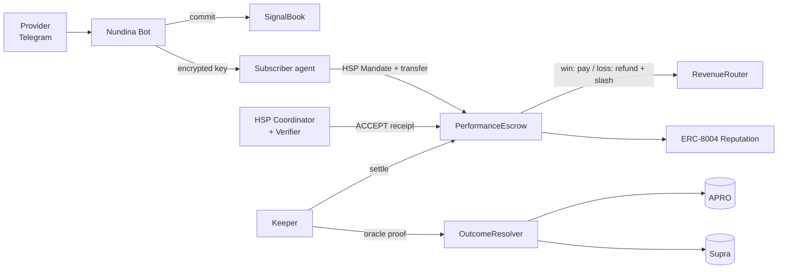

<div align="center">

# Nundina

### Pay only when the call is right.

**Verified, pay-if-right trading signals, settled agent-to-agent on HashKey Chain through HSP.**

`HashKey Chain` · `HSP` · `ERC-8004` · `APRO + Supra oracles` · `Telegram` · `MCP`

*Built for the HashKey Chain Horizon Hackathon (Mumbai Edition): Track 2, Agent Payments & A2A Settlement*

</div>

---

## The problem

Thousands of Telegram "VIP signal" groups charge **₹700–7,000 a month**, and their only proof is **screenshots**, which are easy to fake. Losing calls get deleted, win rates are made up, and scams worth lakhs of rupees make the news in India every month. Honest providers have no way to prove they're honest, and subscribers have no way to get their money back.

## The solution

Nundina makes a trading signal **impossible to fake and risk-free to buy**.

1. **Lock.** A provider posts a signal in Telegram as usual. Nundina **commits it on HashKey Chain before the price moves**, timestamped and impossible to change or delete.
2. **Pay.** A subscriber, or their AI agent, pays per signal through **HSP** into an on-chain escrow. They receive the encrypted signal right away.
3. **Settle.** HashKey's on-chain oracles (**APRO, Supra**) decide the result.
   - ✅ **Right:** the provider gets paid.
   - ❌ **Wrong:** the subscriber is **refunded automatically**, plus a slice of the provider's bond.
4. **Prove.** Every call is revealed and scored. The track record is written to **ERC-8004** reputation, so it is public, unforgeable and portable.

> **Every call counts.** A provider can't delete losers, hide "test" calls, or post both sides. An unrevealed signal is an automatic loss.

## Why traders can trust it

| Rule | What it means |
|---|---|
| 💸 **Refund if wrong** | Payment sits in escrow and comes back automatically when the call fails |
| 🔒 **Every call counts** | Each signal is committed before the move, with no edits or deletes. An unrevealed signal counts as a loss |
| 📊 **Skill, not luck** | Ranking needs 30+ signals and uses the Wilson lower bound, expectancy in R, and alpha vs simply holding BTC |
| 🪙 **Skin in the game** | Providers post a bond that is slashed on losses, so coin-flip posting loses money by design |
| 👥 **Real follower results** | Shows what followers actually made after fees and slippage, not the provider's claims |
| 🛡️ **Pump-and-dump protection** | Liquid oracle markets only, plus wallet-link monitoring and slashing |
| 🧾 **No need to trust us** | Escrow holds the funds, oracles decide outcomes, scoring is open source, and KYC comes from HSP attestations |

## Agent-to-agent (A2A) settlement

- **Strategy agents** post signals, so the marketplace has supply from day one.
- **Execution agents** buy signals within user-signed budgets (HSP Mandates + `@hsp/mcp` SpendGuard) and can trade them on **HSKSwap**.
- **Aggregator agents** buy many signals, blend them into a meta-signal and resell it. When it wins, `RevenueRouter` **splits the payout back to the upstream providers automatically**, across multiple hops.
- **MCP server:** any AI agent (Claude, OpenClaw, AgentKit) can discover, verify and buy signals.

## Architecture



| Contract | Role |
|---|---|
| `SignalBook` | Commit-reveal of signals; automatic loss if unrevealed |
| `PerformanceEscrow` | Holds HSP payments; pays on a win, refunds and slashes on a loss; permissionless refund fallback |
| `OutcomeResolver` | APRO push + Supra pull adapters; TP/SL touch proofs with a challenge window |
| `RevenueRouter` | Multi-hop payout splits for aggregator signals |
| `ProviderRegistry` | Provider profiles, bonds, HSP KYC attestation badge |
| `ERC-8004 Identity + Reputation` | Portable agent identity and track record (first deployment on HashKey) |

Full design: [`Idea/05-architecture.md`](Idea/05-architecture.md)

## Why HashKey Chain

- **HSP** provides non-custodial, verifiable stablecoin settlement with **KYC and sanctions attestations built in**, so the "Verified Provider" badge comes from the payment protocol itself.
- **Live on-chain oracles:**
  - APRO BTC/USD feed: `0x204E…360F`
  - APRO HSK/USD feed: `0x86CE…224b`
  - Supra pull contract: `0x16f7…C3dD`
- **Near-free gas:** about **$0.004 per signal commit**, so we sponsor every provider.
- **USDT and USDC.e** (EIP-3009) for payments, **HSKSwap** for execution, and **HashKey AgentKit** for agent wallets.
- **ERC-8004 isn't on HashKey yet.** Nundina brings it.

## Tech stack

| Layer | Tech |
|---|---|
| Contracts | Solidity, Foundry (tests fork HashKey mainnet), OpenZeppelin |
| Payments | HSP Coordinator (evm-transfer mandates + receipts), mock rail until credentials; x402 + EIP-3009 via USDC.e |
| Oracles | APRO (push), Supra (pull) |
| Bot | grammY (TypeScript) + Telegram Mini App + WalletConnect |
| Backend | Node 24, Hono, viem, Postgres (drizzle, pg-boss), Ponder indexer |
| Agents | viem accounts per agent, Claude Haiku (sentiment), MCP SDK |
| AI parsing | Cornix-format rules + Claude Haiku structured extraction |
| Encryption | AES-256-GCM per signal + ECIES key wrapping per subscriber |
| Web | Next.js, Tailwind, shadcn/ui, lightweight-charts |

Why each choice: [`Idea/06-tech-stack.md`](Idea/06-tech-stack.md)

## Live links

| | |
|---|---|
| Web app | _pending production deploy_ (`apps/web`, Vercel) |
| Telegram bot + Mini App | _pending_ (`@BotFather` username in `NEXT_PUBLIC_BOT_USERNAME`) |
| MCP server | _pending_ (`https://<mcp-host>/mcp`, see [`apps/mcp/README.md`](apps/mcp/README.md)) |
| Status page | `/status` on the web app (API, relayer, keeper, settlements, HSP) |
| Demo video | _pending_ |

**Payments mode.** HSP runs in **mock mode** (`HSP_MODE=mock`, a local `MockRail` that runs the same evm-transfer mandate and receipt flow) until HSP credentials are issued. The escrow, credits, refunds and settlement are the real contracts in both modes.

## Contract addresses

**Testnet (HashKey Chain 133): deployed 27 Oct 2026** with HSP's testnet USDT/USDC as payment tokens; roles checked on-chain and smoke-tested. The organizers confirmed testnet is fine for the demo; mainnet comes after winning.

Mainnet (HashKey Chain 177): **not deployed yet.** The deploy is guarded by `CONFIRM_MAINNET=yes` and waits for a funded deployer (see `NEEDS-FROM-USER.md`). Once deployed, `pnpm contracts:export` fills this table with [Blockscout](https://hsk.blockscout.com) links.

| Contract | Mainnet (177) | Testnet (133) |
|---|---|---|
| SignalBook | _pending_ | `0xCbA92a5a4B7f785E0DBe3cf40BD243242395f8aa` |
| PerformanceEscrow | _pending_ | `0x1dc2F824Da90EAd40e655e6a681979aEE6535416` |
| OutcomeResolver | _pending_ | `0x008dDB1a2150941E3b56d1a31bD9ce6832Fa8589` |
| RevenueRouter | _pending_ | `0x1Efe8317BDA4572b39532F7eb160FF1D0EBA45D9` |
| ProviderRegistry | _pending_ | `0x56898432063bD084a30448032087216cC07A2A14` |
| SignerCreditVerifier | _pending_ | `0x76E24B4B7aF6581970401336bD4898CDbD23a525` |
| ERC-8004 Identity / Reputation | _pending_ | `0x4A9F0482B16146b9564143A15a1B6d26Ffd072D9` / `0x3aF449FB0e190799342F9ff00f9175Ba35C2834d` |
| Timelock (admin of all) | _pending_ | `0xD264D767C0D3A75030dE7b5AB926D58d09e3626A` |
| USDT | [`0xF1B5…9029`](https://hsk.blockscout.com/address/0xF1B50eD67A9e2CC94Ad3c477779E2d4cBfFf9029) | `0x372325443233fEbaC1F6998aC750276468c83CC6` (HSP test) |
| USDC.e | [`0x054e…8D0a`](https://hsk.blockscout.com/address/0x054ed45810DbBAb8B27668922D110669c9D88D0a) | `0x8FE3cB719Ee4410E236Cd6b72ab1fCDC06eF53c6` (HSP test) |

Local (anvil) addresses and the deploy runbook are in [`contracts/DEPLOYMENTS.md`](contracts/DEPLOYMENTS.md). The security model, admin powers and the pre-mainnet review (Slither triage included) are in [`contracts/SECURITY.md`](contracts/SECURITY.md).

## Repository structure

```
Nundina/
├── contracts/        Foundry: SignalBook, PerformanceEscrow, OutcomeResolver (+ APRO/Supra adapters),
│                     RevenueRouter, ProviderRegistry, SignerCreditVerifier, ERC-8004 registries
├── packages/shared/  EIP-712 types, scoring library, markets, ABIs + addresses, job names
├── apps/api/         Hono API: auth (SIWE, Telegram, API keys), relayer, HSP rails, key service, jobs, /status
├── apps/bot/         Telegram bot (grammY): channel parser, lock cards, notifications
├── apps/keeper/      Touch watcher, challenges, finalize/settle, expiry, sweeps
├── apps/indexer/     Ponder indexer + projector into the API database
├── apps/web/         Next.js: leaderboard, provider/signal pages, dashboards, Telegram Mini App
├── apps/mcp/         MCP server for external agents (x402 / credits, delegated buys)
├── agents/           core runtime + momentum, funding, sentiment, execution, aggregator agents
├── Idea/ Architecture/ Memory/ Prompts/   product docs, design, build log
└── TRACTION.md       providers, signals, purchases, refunds, volume
```

## Run it locally

Needs Node 24, pnpm 11, Docker and [Foundry](https://getfoundry.sh).

```bash
pnpm i
docker compose up -d postgres            # or: pnpm db:up
cp .env.example .env                     # then fill in keys (KEY_SERVICE_MASTER_KEY, INTERNAL_SECRET, …)
pnpm chain:local                         # anvil on :8545 (separate terminal)
pnpm contracts:deploy:local && pnpm contracts:export
pnpm --filter @nundina/api db:migrate && pnpm --filter @nundina/api db:seed
pnpm --filter @nundina/api dev           # API on :8787
pnpm --filter @nundina/keeper dev        # keeper
pnpm --filter @nundina/bot dev           # Telegram bot (needs TELEGRAM_BOT_TOKEN)
pnpm --filter @nundina/web dev           # web on :3000
pnpm --filter @nundina/mcp start         # MCP on :8791
pnpm --filter @nundina/agent-momentum start   # any agent (agents/*/README.md)
```

Demos on a local chain:
- `pnpm --filter @nundina/keeper demo:aggregator` runs the full A2A flow: two providers, an aggregator meta-signal, an execution agent buying it, settlement, and `Routed` payouts to both upstreams.
- `pnpm --filter @nundina/agent-aggregator stage-demo` (testnet/mainnet) pre-stages a short-expiry LONG/SHORT pair (one WIN, one LOSS) plus an aggregator meta-signal for recording.
- `pnpm contracts:check-roles:local` deploys to a throwaway anvil and checks every role and wiring against `Deploy.s.sol`. Run `pnpm contracts:check-roles` against 177 after the mainnet deploy.

## Tests

```bash
pnpm contracts:test      # forge: 112 tests (unit, fuzz, invariants, mainnet-fork oracle tests)
pnpm test                # every package, sequentially (shared Postgres test DB + anvil)
pnpm typecheck
```

CI (`.github/workflows/ci.yml`) runs install → typecheck → test → forge test → `pnpm audit` on every push.

## Roadmap

- [x] Research, product design and architecture ([`Idea/`](Idea/README.md))
- [x] Core contracts: commit-reveal, escrow, settlement, bonds, timelocked admin
- [x] HSP payments (mock + live rail), receipt verification, escrow credit
- [x] ERC-8004 identity + reputation registries
- [x] Telegram bot (provider and subscriber flows) + Mini App
- [x] Keeper, indexer, scoring, web leaderboard and dashboards
- [x] Strategy, execution and aggregator agents, plus the MCP server
- [x] Security pass: Slither triage, role checks, rate limits, monitoring
- [ ] Mainnet deployment and verification on Blockscout
- [ ] Onboard the first real Telegram signal providers ([`TRACTION.md`](TRACTION.md))

**Later:** threshold or TEE encryption, pay-if-right for *any* verifiable prediction (prediction markets, funding rates, sports), an agent-to-agent alpha exchange, reputation-backed agent credit.

## Documentation

| Doc | |
|---|---|
| [Idea and trust design](Idea/01-idea-and-trust.md) | How it works and why traders can trust it |
| [Why this](Idea/02-why-this.md) | Problem, demand, why now, Track 2 fit |
| [Competitors](Idea/03-competitors.md) | Myfxbook, Collective2, Cornix, copy trading, Hyperliquid, Bittensor… |
| [Why HashKey](Idea/04-why-hashkey.md) | HSP, oracles, gas, ecosystem; addresses verified on-chain |
| [Architecture](Idea/05-architecture.md) | Contracts, flows, anti-gaming |
| [Tech stack](Idea/06-tech-stack.md) | Choices and reasons |
| [Deliverables and plan](Idea/07-deliverables-and-plan.md) | 8-day plan and demo script |
| [Go-to-market](Idea/08-go-to-market.md) | Cold start, business model, future |
| [Risks](Idea/09-risks.md) | Risks and mitigations |
| [Research archive](Idea/10-research-archive.md) | All research and sources |

## Disclaimer

Nundina is **verification and settlement infrastructure**. It does not provide investment advice. Signals are created by independent providers, who are responsible for their own compliance. Past results do not predict future results. Crypto trading carries risk, and you can lose more than the price of a signal; the refund covers only that price. Smart contracts, oracles and payment rails can fail. Full terms: `/legal` on the web app.

---

<div align="center">

**Nundina: pay only when the call is right.**

Built on HashKey Chain · Powered by HSP

</div>
