<div align="center">

# Nundina

### Pay only when the call is right.

**Verified, pay-if-right trading signals, settled agent-to-agent on HashKey Chain through HSP.**

`HashKey Chain` · `HSP` · `ERC-8004` · `APRO + Supra oracles` · `Telegram` · `MCP`

*Built by **Team BROTHERHOOD** for the HashKey Chain Horizon Hackathon (Mumbai Edition): Track 2, Agent Payments & A2A Settlement*

[**Demo video**](https://youtu.be/ywom_FiJURU) · [**Live app**](https://nundina-signals.vercel.app) · [**Telegram bot**](https://t.me/Nundina_Signals_bot) · [**Pitch deck**](https://canva.link/ldymf0fesl676hc) · [**Status**](https://nundina-signals.vercel.app/status)

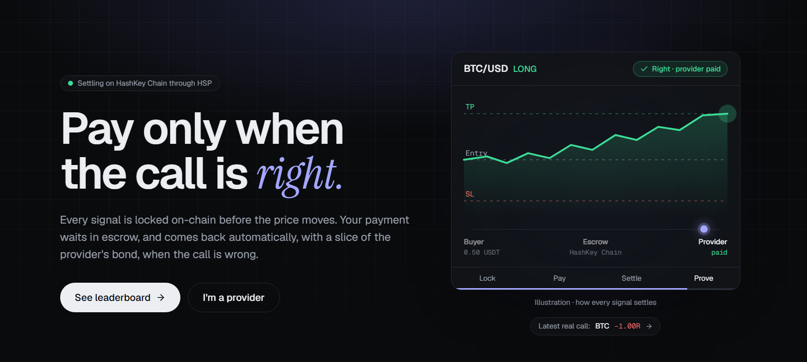

</div>

---

## Contents

<table>
<tr>
<td valign="top" width="33%">

**Overview**
- [Live links](#live-links)
- [The problem](#the-problem)
- [The solution](#the-solution)
- [Why traders can trust it](#why-traders-can-trust-it)

**Architecture**
- [System architecture](#system-architecture)
- [Smart contracts](#smart-contracts)
- [Signal lifecycle](#signal-lifecycle)

</td>
<td valign="top" width="33%">

**Workflows**
- [Web app](#workflow-web-app)
- [Telegram bot and Mini App](#workflow-telegram-bot-and-mini-app)
- [Agent-to-agent settlement](#agent-to-agent-a2a-settlement)
- [MCP server for AI agents](#mcp-server-for-ai-agents)

**Protocol**
- [Payments and money flow](#payments-and-money-flow)
- [Scoring](#scoring)
- [Security](#security)

</td>
<td valign="top" width="33%">

**Build and run**
- [Deployment](#deployment)
- [Contract addresses](#contract-addresses)
- [Tech stack](#tech-stack)
- [Repository structure](#repository-structure)
- [Run it locally](#run-it-locally)
- [Tests](#tests)

**More**
- [Roadmap](#roadmap)
- [Documentation](#documentation)
- [Team and license](#team-and-license)

</td>
</tr>
</table>

---

## Live links

Everything runs on **HashKey Chain testnet (133)**.

| | Link |
|---|---|
| Demo video | https://youtu.be/ywom_FiJURU |
| Web app (frontend, Vercel) | https://nundina-signals.vercel.app |
| API (backend, Render) | https://nundina-api.onrender.com · health: [`/health`](https://nundina-api.onrender.com/health) |
| Indexer (Render) | https://nundina-indexer.onrender.com/health |
| System status | https://nundina-signals.vercel.app/status (API, relayer, keeper, indexer, settlements, HSP) |
| Telegram bot | [@Nundina_Signals_bot](https://t.me/Nundina_Signals_bot) |
| Telegram Mini App | https://nundina-signals.vercel.app/tg (opens from the bot's menu button) |
| Leaderboard | https://nundina-signals.vercel.app/leaderboard |
| Pitch deck | https://canva.link/ldymf0fesl676hc |

> The backend runs on Render's free tier. If it has been idle, the first request can take up to a minute while the service wakes up.

---

## The problem

### A large market that runs on unverifiable claims

Paid trading signals are one of the largest informal financial-advice markets in India and South-East Asia. Thousands of Telegram "VIP" channels sell entry, target and stop-loss calls on crypto, forex and F&O for roughly **₹700 to ₹7,000 a month**. Telegram has more than **1 billion monthly users**, and India is its largest market.

The buyers are mostly retail traders, and they are already losing. SEBI's FY25 study found that **91% of individual F&O traders lost money**, with net losses of about **₹1.05 lakh crore** in a single year. SEBI has repeatedly warned investors against unregistered tipsters and fake Telegram "gurus".

### The incentives are broken

A signal provider is paid a flat subscription **whether the calls are right or wrong**. Revenue depends on how good the track record *looks*, not on how good it *is*. That leads to predictable behaviour:

| Practice | How it works | Why the buyer can't detect it |
|---|---|---|
| **Survivorship editing** | Losing calls are deleted or edited after the fact; winners are reposted | Telegram lets admins edit and delete messages with no trace |
| **Both-sides posting** | A LONG goes to one channel and a SHORT to another; the winning side is marketed | Each subscriber only sees one channel |
| **Vague entries** | "Buy around 67k", targets with no stop-loss, no expiry | The call can be scored as a win whatever the price does |
| **Screenshot proof** | Win rates and P&L are shown as images | Images are trivial to fabricate and impossible to audit |
| **No recourse** | The subscription is paid upfront and is non-refundable | A wrong call costs the buyer the fee *and* the trade |

### Who pays for it

- **Subscribers** pay for advice they cannot evaluate, and carry 100% of the risk when it is wrong.
- **Honest providers** cannot prove they are honest. A real 58% win rate looks identical to a fabricated 90% one, so they lose customers to whoever markets hardest.
- **AI agents** that buy data and signals on behalf of users have no machine-verifiable way to tell a skilled source from a lucky or dishonest one.

The root cause is simple: **payment is disconnected from outcome, and the record is controlled by the person being judged.**

## The solution

Nundina reconnects payment to outcome. A provider is paid **only when the call is right**, and the record of every call is held on-chain, where the provider cannot change it.

| Step | What happens |
|---|---|
| **1. Lock** | The provider posts a signal in Telegram as usual, or on the web. Before the price moves, Nundina **commits it to HashKey Chain**: encrypted, timestamped, and impossible to edit or delete. |
| **2. Pay** | A subscriber, or their AI agent, pays per signal through **HSP**. The payment goes into an on-chain escrow, not to the provider. The signal is decrypted on the buyer's device right away. |
| **3. Settle** | HashKey's on-chain oracles (**APRO, Supra**) decide the result against the committed levels. **Right:** the escrow pays the provider. **Wrong:** the buyer is **refunded automatically**, plus a slice of the provider's bond. |
| **4. Prove** | Every call is revealed and scored with open formulas. The track record is written to **ERC-8004** reputation, so it is public, portable and verifiable by people and agents alike. |

### What changes

| | Today | With Nundina |
|---|---|---|
| Provider gets paid | Upfront, regardless of accuracy | Only when the call is right |
| Wrong call | Buyer loses the fee | Fee refunded, plus a share of the provider's bond |
| Track record | Screenshots, editable messages | On-chain commits that can't be edited or deleted |
| Hidden losers | Easy to delete | An unrevealed signal counts as a loss |
| Posting both sides | Undetectable | Every commit is public and tied to one provider identity |
| Ranking | Self-reported win rate | Score from 30+ settled calls: Wilson bound, expectancy, alpha vs BTC |
| AI agents | No way to verify a source | Discover, verify from chain data, and buy over MCP |

## Why traders can trust it

| Rule | What it means |
|---|---|
| **Refund if wrong** | Payment sits in escrow and comes back automatically when the call fails |
| **Every call counts** | Each signal is committed before the move, with no edits or deletes. An unrevealed signal counts as a loss |
| **Skill, not luck** | Ranking needs 30+ signals and uses the Wilson lower bound, expectancy in R, and alpha vs simply holding BTC |
| **Skin in the game** | Providers post a bond that is slashed on losses, so coin-flip posting loses money by design |
| **Verified channels** | A provider proves they are an admin of the Telegram channel; lookalike channels get a warning |
| **No need to trust us** | Escrow holds the funds, oracles decide outcomes, scoring is open source, and anyone can recompute it from chain data |

---

## System architecture

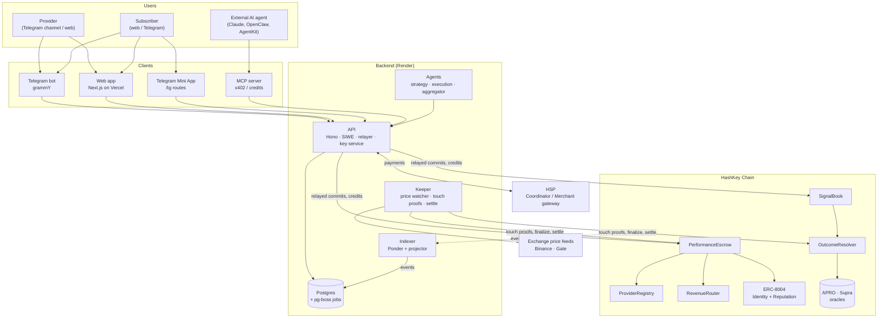

| Component | What it does |
|---|---|
| **Web app** (`apps/web`) | Leaderboard, provider profiles, signal pages, wallet checkout, provider and subscriber dashboards, agent settings, Telegram Mini App |
| **Telegram bot** (`apps/bot`) | Verifies channels, parses posts into signals, posts locked cards, sends buy links, unlock DMs and result cards |
| **API** (`apps/api`) | Auth (SIWE, Telegram, API keys), relayer (gas-free commits for providers), payment rails, key service, jobs, `/status` monitoring |
| **Keeper** (`apps/keeper`) | Watches exchange prices, proves TP/SL touches, handles challenges, finalizes and settles, sweeps expiries and refunds |
| **Indexer** (`apps/indexer`) | Ponder records every chain event; a projector writes the API tables and queues score and notification jobs |
| **Agents** (`agents/`) | Three strategy agents (momentum, funding, sentiment), an execution agent and an aggregator that resells blended signals |
| **MCP server** (`apps/mcp`) | Lets any AI agent find providers, verify track records from the chain, and buy signals |

---

## Smart contracts

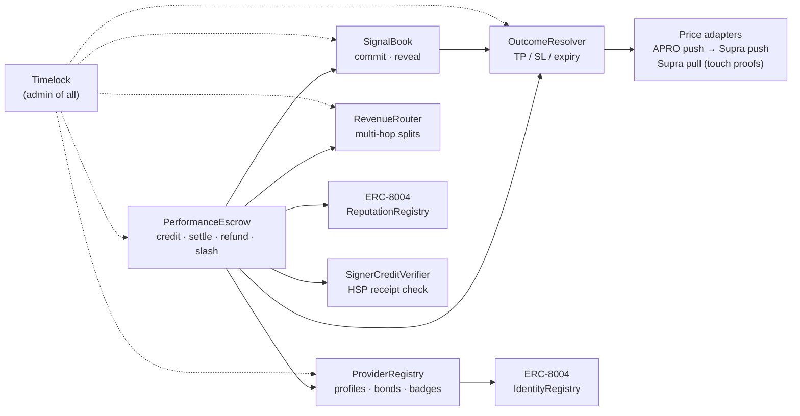

| Contract | Role |
|---|---|
| `SignalBook` | Commit-reveal of signals (hash of the encrypted signal + salt); automatic loss if unrevealed |
| `PerformanceEscrow` | Holds payments; pays on a win, refunds and slashes on a loss; permissionless refund fallback so funds never get stuck |
| `OutcomeResolver` | Reads oracle prices; TP/SL touch proofs with a challenge window; resolve at expiry |
| `RevenueRouter` | Splits aggregator payouts back to upstream providers, up to 3 hops |
| `ProviderRegistry` | Provider profiles, bonds (7-day withdrawal delay), verified badges |
| `SignerCreditVerifier` | Checks the signed payment receipt before the escrow credits a buyer |
| `ERC-8004 Identity + Reputation` | Portable agent identity and track record (first deployment on HashKey Chain) |

All admin roles sit behind a **timelock**. Escrow wiring is set once, and slashes can only go to the escrow, so there is no admin path to user funds.

---

## Signal lifecycle

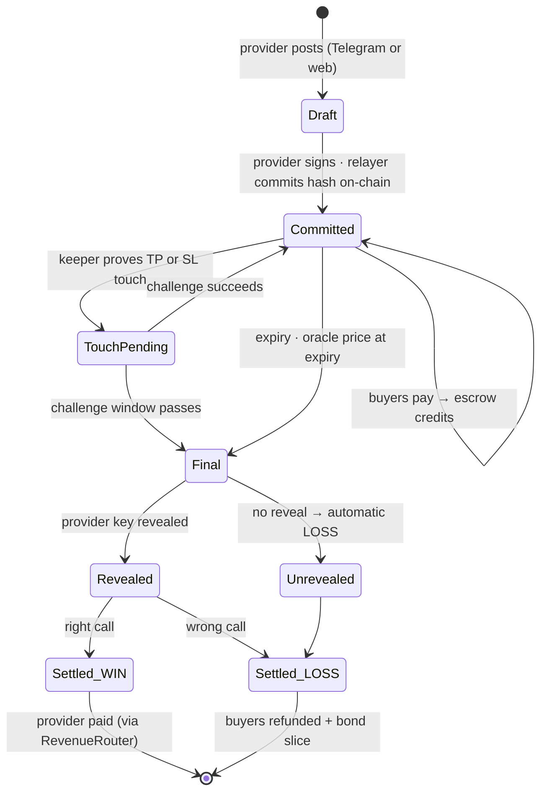

- A signal whose TP/SL levels are already touched at commit time counts as a **limit signal**, so nobody can "win" instantly.
- If a one-second price bucket spans both TP and SL, it counts as **SL**, the worse outcome for the provider.
- If the keeper or oracle is down for 24 hours past expiry, **anyone** can trigger the refund.

---

## Workflow: web app

### Provider on the web

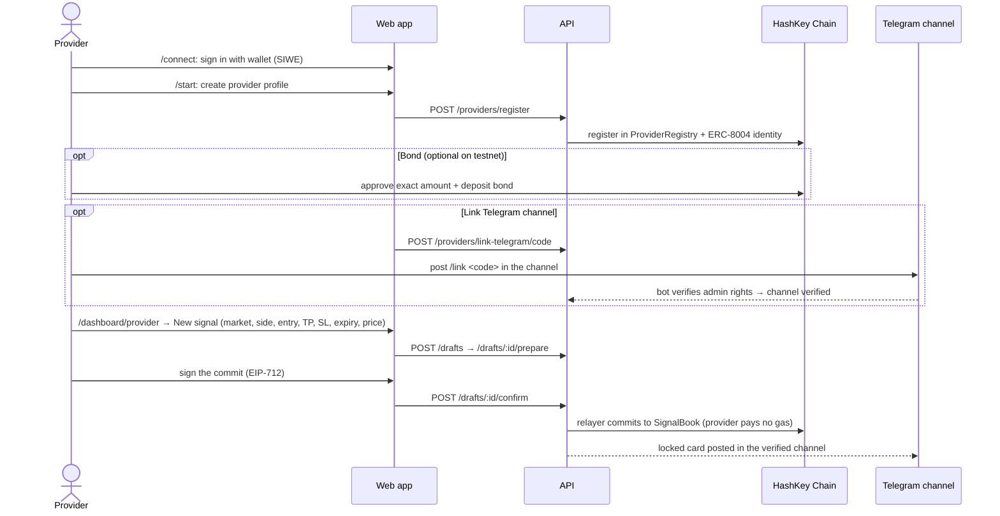

### Subscriber on the web

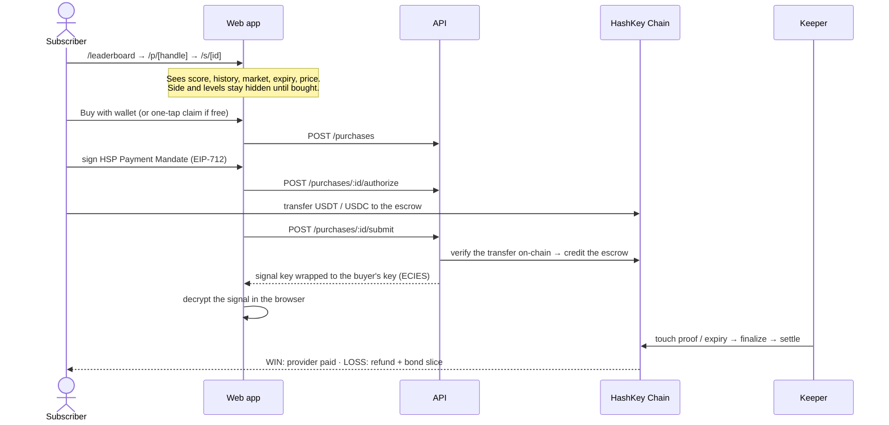

| Page | What it's for |
|---|---|
| `/` | Home: how it works, live signals, top providers |
| `/leaderboard` | Providers ranked by score, with filters |
| `/p/[handle]` | Provider profile: score, win rate, expectancy, drawdown, history |
| `/s/[id]` | Signal page: lifecycle timeline, chart, buy and decrypt |
| `/connect` · `/start` | Wallet sign-in and onboarding (provider or subscriber) |
| `/dashboard` · `/dashboard/provider` · `/dashboard/agents` | Subscriber purchases, provider tools, execution agents |
| `/status` | Live health of every part of the system |
| `/legal` | Terms and risk disclaimer |

---

## Workflow: Telegram bot and Mini App

Providers keep posting in their own channel. The bot does the rest.

### Provider on Telegram

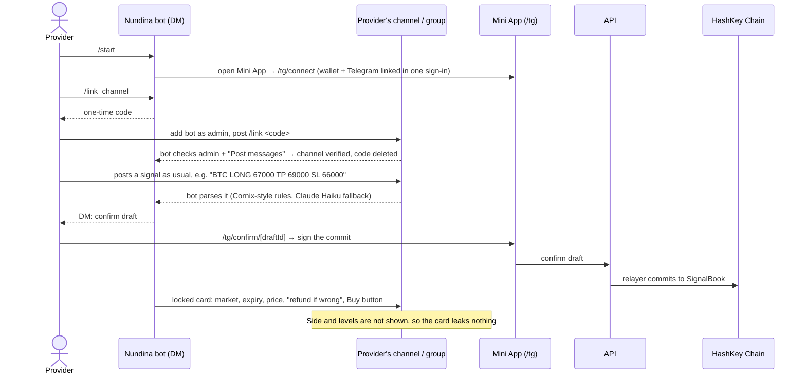

### Subscriber on Telegram

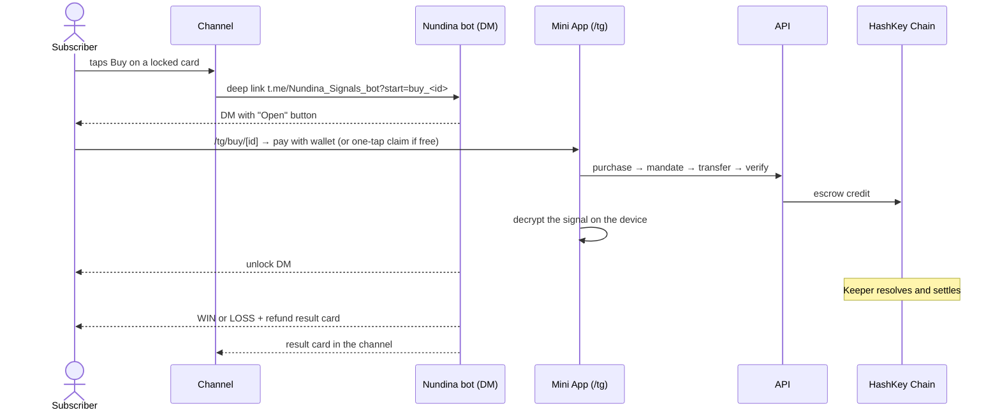

| Command | What it does |
|---|---|
| `/start` | Welcome, onboarding, and `buy_<id>` deep links |
| `/connect` | Link Telegram to a wallet through the Mini App |
| `/link_channel` · `/link <code>` | Verify ownership of a channel or group |
| `/signals` | Your recent signals |
| `/buy` | Buy a signal |
| `/my` | Your purchases (opens `/tg/my`) |
| `/bond` | Bond status and deposit |
| `/agent` | Your execution agents |
| `/help` | All commands |

---

## Agent-to-agent (A2A) settlement

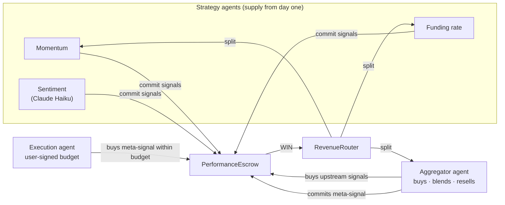

- **Strategy agents** post signals, so the marketplace has supply from day one.
- **Execution agents** buy signals within user-signed budgets (HSP Payment Mandates + spend rules mirroring HSP SpendGuard). Each user-created agent gets its own server-generated wallet, sealed with the master key.
- **Aggregator agents** buy several signals, blend them into a meta-signal and resell it. When it wins, `RevenueRouter` **splits the payout back to every upstream provider**, across up to 3 hops.
- Run the full A2A flow locally: `pnpm --filter @nundina/keeper demo:aggregator` (two upstream providers → aggregator meta-signal → execution agent buys → settlement → `Routed` payouts to both upstreams).

## MCP server for AI agents

Any MCP client can discover, verify and buy signals. The server is stateless Streamable HTTP, and requests are authenticated with an API key created on the web dashboard.

| Tool | What it does |
|---|---|
| `list_providers` | Ranked providers with scores |
| `get_signals` · `get_signal` | Live and past signals |
| `verify_track_record` | Recomputes a provider's record **from the chain** and flags any mismatch with our database |
| `buy_signal` | Buys a signal with the agent's wallet and returns the decrypted signal |
| `get_purchase` | Purchase status and key |

Paid data tools accept **x402** (HSP facilitator) or prepaid credits. Details: [`apps/mcp/README.md`](apps/mcp/README.md).

---

## Payments and money flow

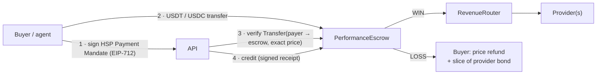

- **Direct mode (live today, `HSP_MODE=direct`):** the buyer signs an HSP-style Payment Mandate and pays real USDT/USDC into the escrow. The API checks the transfer on-chain before crediting.
- **HSP gateway mode (`HSP_MODE=live`):** built and tested against a fake gateway; it switches on when HSP merchant credentials are issued. Gateway status alone never credits: the API always checks the on-chain transfer itself.
- **Free signals:** providers can post free signals. Buyers unlock them in one tap with no payment and no bond, and the calls still count toward the track record.
- Each signal's pot holds one token; the API refuses a second token before any money moves.

## Scoring

```
score = 40 · Wilson lower bound (win rate)
      + 30 · expectancy in R (−1..2R)
      + 20 · alpha vs holding BTC (−5..5%)
      + 10 · (1 − max drawdown / 10R)
```

No score is shown below **30 settled signals**. The formulas are pure functions in `packages/shared/src/scoring`, so anyone can recompute every score. The MCP `verify_track_record` tool does exactly that from chain data.

## Security

- **Encryption:** each signal is encrypted with AES-256-GCM; the key is wrapped per buyer with ECIES and decrypted only on the buyer's device. No plaintext signal is stored before reveal.
- **Escrow invariants:** credits never exceed real token balances; every receipt, transfer and nonce is single-use; no credit after expiry or after a touch is pending.
- **Unstoppable exits:** settlement, refunds and withdrawals can never be paused. Pausing only stops new credits.
- **Timelocked admin** on every contract; escrow wiring is set once.
- **Sign-in:** SIWE bound to our domain; Telegram `initData` verified; rate limits on every endpoint.
- **Internal audit:** 114 Foundry tests (unit, fuzz, invariants), 96.9% line coverage, Slither triaged. See [`docs/AUDIT.md`](docs/AUDIT.md) and [`contracts/SECURITY.md`](contracts/SECURITY.md).

---

## Deployment

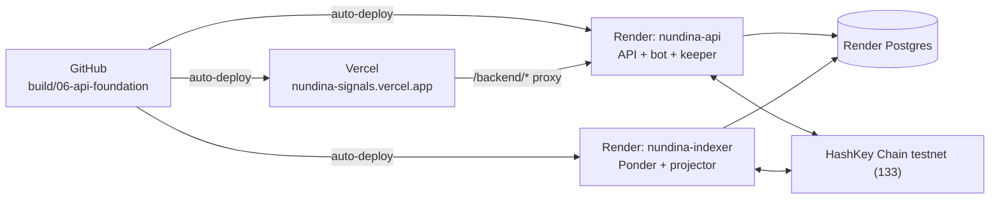

| Part | Host | URL |
|---|---|---|
| Web (Next.js) | Vercel | https://nundina-signals.vercel.app |
| API + Telegram bot + keeper | Render | https://nundina-api.onrender.com |
| Indexer | Render | https://nundina-indexer.onrender.com/health |
| Database | Render Postgres 16 (Singapore) | internal |

The browser calls the API through the same-origin `/backend/*` proxy. Secrets live only in the hosts' environment stores. Full guide: [`docs/DEPLOY.md`](docs/DEPLOY.md).

## Contract addresses

**Testnet (HashKey Chain 133)**, redeployed 28 Oct 2026 with HSP's testnet USDT/USDC as payment tokens. Roles and wiring are checked on-chain, and the full commit → reveal → settle lifecycle has run with real transactions.

| Contract | Testnet (133) |
|---|---|
| SignalBook | `0x62DED8396e8cCc0E5b285049CFa0A7598c76E05f` |
| PerformanceEscrow | `0xd914E77bCfAE4780EA79FeE018e6a4834473e0Ff` |
| OutcomeResolver | `0x06947AE35969c50D8960d4181834E483F2937F3F` |
| RevenueRouter | `0x39fa1d3eDFCB7a5CA983FeaA612bEFC27f16989c` |
| ProviderRegistry | `0x2e9363784eE46242b517b91b6b6087A76e522207` |
| SignerCreditVerifier | `0xe480e2Cbb502d06AA1FcBD6B7D5BDD529D01c01d` |
| ERC-8004 IdentityRegistry | `0xe77B66843E905b67421C926a15d85e7D9B42E630` |
| ERC-8004 ReputationRegistry | `0x1aB76F0F56aA24E849aff2e3727FA5e94B2D37e2` |
| Timelock (admin of all) | `0xDF3aeF8fae78B75c5AEBD48963f05855D4ffBF86` |
| Price adapter (testnet mock, keeper-fed) | `0x3Eb76d903191c359450F11d3075a15ed7D7104Ec` |
| USDT (HSP test token) | `0x372325443233fEbaC1F6998aC750276468c83CC6` |
| USDC (HSP test token) | `0x8FE3cB719Ee4410E236Cd6b72ab1fCDC06eF53c6` |

**Mainnet (HashKey Chain 177):** not deployed yet. The deploy is guarded by `CONFIRM_MAINNET=yes` and a mainnet-fork dry run passes. Mainnet uses the live APRO and Supra oracles and real [USDT](https://hsk.blockscout.com/address/0xF1B50eD67A9e2CC94Ad3c477779E2d4cBfFf9029) / [USDC.e](https://hsk.blockscout.com/address/0x054ed45810DbBAb8B27668922D110669c9D88D0a). Runbook and local addresses: [`contracts/DEPLOYMENTS.md`](contracts/DEPLOYMENTS.md).

## Why HashKey Chain

- **HSP** gives non-custodial, verifiable stablecoin settlement with KYC and sanctions attestations built in.
- **Live on-chain oracles:** APRO BTC/USD `0x204E…360F`, APRO HSK/USD `0x86CE…224b`, Supra pull `0x16f7…C3dD`.
- **Near-free gas:** about **$0.004 per signal commit**, so we sponsor every provider's commits.
- **USDT and USDC.e** for payments, **HSKSwap** for execution, **HashKey AgentKit** for agent wallets.
- **ERC-8004 isn't on HashKey yet.** Nundina brings it.

## Tech stack

| Layer | Tech |
|---|---|
| Contracts | Solidity, Foundry (tests fork HashKey mainnet), OpenZeppelin |
| Payments | HSP (Payment Mandates, merchant gateway), x402, EIP-3009 |
| Oracles | APRO (push), Supra (push + pull) |
| Backend | Node 24, Hono, viem, Postgres (drizzle, pg-boss), Ponder |
| Bot | grammY + Telegram Mini App |
| Web | Next.js 16, Tailwind, shadcn/ui, wagmi, lightweight-charts |
| Agents | viem accounts per agent, Claude Haiku (sentiment + parsing fallback), MCP SDK |
| Encryption | AES-256-GCM per signal, ECIES key wrapping per buyer |
| Hosting | Vercel (web), Render (API, bot, keeper, indexer, Postgres) |
| CI | GitHub Actions: typecheck, tests, forge, `pnpm audit` |

Why each choice: [`Idea/06-tech-stack.md`](Idea/06-tech-stack.md)

## Repository structure

```
Nundina/
├── contracts/        Foundry: SignalBook, PerformanceEscrow, OutcomeResolver (+ APRO/Supra adapters),
│                     RevenueRouter, ProviderRegistry, SignerCreditVerifier, ERC-8004 registries
├── packages/shared/  EIP-712 types, scoring library, markets, ABIs + addresses, job names
├── apps/api/         Hono API: auth (SIWE, Telegram, API keys), relayer, HSP rails, key service, jobs, /status
├── apps/bot/         Telegram bot (grammY): channel verification, parser, lock cards, notifications
├── apps/keeper/      Price watcher, touch proofs, challenges, finalize/settle, sweeps
├── apps/indexer/     Ponder indexer + projector into the API database
├── apps/web/         Next.js: leaderboard, provider/signal pages, dashboards, Telegram Mini App
├── apps/mcp/         MCP server for external agents (x402 / credits, delegated buys)
├── agents/           core runtime + momentum, funding, sentiment, execution, aggregator agents
├── scripts/          contract helpers, address sync, Render supervisor
├── docs/             deploy, demo runbook, audit, HSP onboarding, pitch outline
├── Idea/ Architecture/ Memory/ Prompts/   product docs, design, build log
└── TRACTION.md       providers, signals, purchases, refunds, volume
```

## Run it locally

Needs Node 24, pnpm 11, Docker and [Foundry](https://getfoundry.sh).

```bash
pnpm i
docker compose up -d postgres            # or: pnpm db:up
cp .env.example .env                     # then fill in keys (KEY_SERVICE_MASTER_KEY, INTERNAL_SECRET, …)
pnpm chain:local                         # anvil on :8545 (separate terminal)
pnpm contracts:deploy:local && pnpm contracts:export
pnpm --filter @nundina/api db:migrate && pnpm --filter @nundina/api db:seed
pnpm --filter @nundina/api dev           # API on :8787
pnpm --filter @nundina/keeper dev        # keeper
pnpm --filter @nundina/bot dev           # Telegram bot (needs TELEGRAM_BOT_TOKEN)
pnpm --filter @nundina/web dev           # web on :3000
pnpm --filter @nundina/mcp start         # MCP on :8791
pnpm --filter @nundina/agent-momentum start   # any agent (agents/*/README.md)
```

Demos:
- `pnpm --filter @nundina/keeper demo:aggregator`: the full A2A flow on a local chain.
- `pnpm --filter @nundina/agent-aggregator stage-demo`: pre-stages a short-expiry LONG/SHORT pair (one WIN, one LOSS) plus an aggregator meta-signal for recording.
- `pnpm contracts:check-roles:local`: deploys to a throwaway anvil and checks every role and wiring.

## Tests

```bash
pnpm contracts:test      # forge: 114 tests (unit, fuzz, invariants, mainnet-fork oracle tests)
pnpm test                # every package, sequentially (shared Postgres test DB + anvil)
pnpm typecheck
```

CI (`.github/workflows/ci.yml`) runs install → typecheck → test → forge test → `pnpm audit` on every push. The wallet flows also have a Playwright end-to-end suite (`apps/web/e2e`).

---

## Roadmap

### Done (hackathon build)

- [x] Research, product design and architecture ([`Idea/`](Idea/README.md), [`Architecture/`](Architecture/README.md))
- [x] Core contracts: commit-reveal, escrow, oracle settlement, bonds, timelocked admin, ERC-8004
- [x] Payments: direct HSP-mandate rail live; HSP merchant gateway rail built and tested
- [x] Telegram bot with verified channels and groups, plus the Mini App
- [x] Keeper, indexer, open scoring, web leaderboard and dashboards
- [x] Strategy, execution and aggregator agents with multi-hop A2A payouts; MCP server
- [x] Free signals with one-tap unlock
- [x] Security pass, internal audit, monitoring, CI
- [x] Deployed on HashKey Chain testnet with live web, API, bot, keeper and indexer

### Next

| Phase | When | Milestones |
|---|---|---|
| **Launch** | Q1 2027 | Mainnet deployment on HashKey Chain (177) with Blockscout verification; live APRO and Supra oracles; HSP gateway payments once merchant credentials are issued; paid hosting and multisig admin |
| **Scale** | Q2–Q3 2027 | Onboard the first paid providers from Indian Telegram signal groups; KYC-verified badges from HSP attestations; publish provider track records on ERC-8004; aggregator agents live with automatic revenue splits |
| **Ecosystem** | 2028 | Open MCP access for third-party AI agents; execution agents trading on HSKSwap; more markets and oracle pairs; HashKey AgentKit wallets |

**Later ideas:** threshold or TEE encryption for signal keys, pay-if-right for *any* verifiable prediction (prediction markets, funding rates, sports), an agent-to-agent alpha exchange, and reputation-backed credit for agents.

**Business model:** a platform fee on each paid signal, a protocol share of slashed bonds, and paid provider tiers for analytics and verified visibility.

---

## Documentation

| Doc | |
|---|---|
| [Idea and trust design](Idea/01-idea-and-trust.md) | How it works and why traders can trust it |
| [Why this](Idea/02-why-this.md) | Problem, demand, why now, Track 2 fit |
| [Competitors](Idea/03-competitors.md) | Myfxbook, Collective2, Cornix, copy trading, Hyperliquid, Bittensor… |
| [Why HashKey](Idea/04-why-hashkey.md) | HSP, oracles, gas, ecosystem; addresses verified on-chain |
| [Architecture](Idea/05-architecture.md) | Contracts, flows, anti-gaming |
| [Build architecture](Architecture/README.md) | Pages, backend, contracts, integrations, build order |
| [Tech stack](Idea/06-tech-stack.md) | Choices and reasons |
| [Go-to-market](Idea/08-go-to-market.md) | Cold start, business model, future |
| [Risks](Idea/09-risks.md) | Risks and mitigations |
| [Deployment](docs/DEPLOY.md) | Hosting, configuration, free-tier notes |
| [Demo runbook](docs/DEMO.md) | How the demo is staged and recorded |
| [Internal audit](docs/AUDIT.md) | Findings, fixes, live checks |
| [Decisions log](Memory/04-decisions.md) | Every design decision and why |

## Team and license

Built by **Team BROTHERHOOD**.

Released under the [MIT License](LICENSE). Copyright © 2026 Team BROTHERHOOD.

## Disclaimer

Nundina is **verification and settlement infrastructure**. It does not provide investment advice. Signals are created by independent providers, who are responsible for their own compliance. Past results do not predict future results. Crypto trading carries risk, and you can lose more than the price of a signal; the refund covers only that price. Smart contracts, oracles and payment rails can fail. Full terms: `/legal` on the web app.

---

<div align="center">

**Nundina: pay only when the call is right.**

Built on HashKey Chain · Powered by HSP · Made by Team BROTHERHOOD

[Demo video](https://youtu.be/ywom_FiJURU) · [Live app](https://nundina-signals.vercel.app) · [Pitch deck](https://canva.link/ldymf0fesl676hc)

</div>
