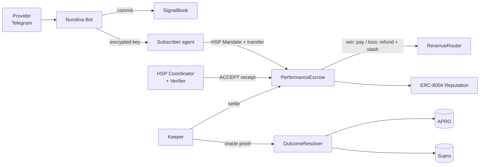

<div align="center">

# Nundina

### Pay only when the call is right.

**Verified, pay-if-right trading signals, settled agent-to-agent on HashKey Chain through HSP.**

`HashKey Chain` · `HSP` · `ERC-8004` · `APRO + Supra oracles` · `Telegram` · `MCP`

*Built for the HashKey Chain Horizon Hackathon (Mumbai Edition): Track 2, Agent Payments & A2A Settlement*

</div>

---

## The problem

Thousands of Telegram "VIP signal" groups charge **₹700–7,000 a month**, and their only proof is **screenshots**, which are easy to fake. Losing calls get deleted, win rates are made up, and scams worth lakhs of rupees make the news in India every month. Honest providers have no way to prove they're honest, and subscribers have no way to get their money back.

## The solution

Nundina makes a trading signal **impossible to fake and risk-free to buy**.

1. **Lock.** A provider posts a signal in Telegram as usual. Nundina **commits it on HashKey Chain before the price moves**, timestamped and impossible to change or delete.
2. **Pay.** A subscriber, or their AI agent, pays per signal through **HSP** into an on-chain escrow. They receive the encrypted signal right away.
3. **Settle.** HashKey's on-chain oracles (**APRO, Supra**) decide the result.
   - ✅ **Right:** the provider gets paid.
   - ❌ **Wrong:** the subscriber is **refunded automatically**, plus a slice of the provider's bond.
4. **Prove.** Every call is revealed and scored. The track record is written to **ERC-8004** reputation, so it is public, unforgeable and portable.

> **Every call counts.** A provider can't delete losers, hide "test" calls, or post both sides. An unrevealed signal is an automatic loss.

## Why traders can trust it

| Rule | What it means |
|---|---|
| 💸 **Refund if wrong** | Payment sits in escrow and comes back automatically when the call fails |
| 🔒 **Every call counts** | Each signal is committed before the move, with no edits or deletes. An unrevealed signal counts as a loss |
| 📊 **Skill, not luck** | Ranking needs 30+ signals and uses the Wilson lower bound, expectancy in R, and alpha vs simply holding BTC |
| 🪙 **Skin in the game** | Providers post a bond that is slashed on losses, so coin-flip posting loses money by design |
| 👥 **Real follower results** | Shows what followers actually made after fees and slippage, not the provider's claims |
| 🛡️ **Pump-and-dump protection** | Liquid oracle markets only, plus wallet-link monitoring and slashing |
| 🧾 **No need to trust us** | Escrow holds the funds, oracles decide outcomes, scoring is open source, and KYC comes from HSP attestations |

## Agent-to-agent (A2A) settlement

- **Strategy agents** post signals, so the marketplace has supply from day one.
- **Execution agents** buy signals within user-signed budgets (HSP Mandates + `@hsp/mcp` SpendGuard) and can trade them on **HSKSwap**.
- **Aggregator agents** buy many signals, blend them into a meta-signal and resell it. When it wins, `RevenueRouter` **splits the payout back to the upstream providers automatically**, across multiple hops.
- **MCP server:** any AI agent (Claude, OpenClaw, AgentKit) can discover, verify and buy signals.

## Architecture



| Contract | Role |
|---|---|
| `SignalBook` | Commit-reveal of signals; automatic loss if unrevealed |
| `PerformanceEscrow` | Holds HSP payments; pays on a win, refunds and slashes on a loss; permissionless refund fallback |
| `OutcomeResolver` | APRO push + Supra pull adapters; TP/SL touch proofs with a challenge window |
| `RevenueRouter` | Multi-hop payout splits for aggregator signals |
| `ProviderRegistry` | Provider profiles, bonds, HSP KYC attestation badge |
| `ERC-8004 Identity + Reputation` | Portable agent identity and track record (first deployment on HashKey) |

Full design: [`Idea/05-architecture.md`](Idea/05-architecture.md)

## Why HashKey Chain

- **HSP** provides non-custodial, verifiable stablecoin settlement with **KYC and sanctions attestations built in**, so the "Verified Provider" badge comes from the payment protocol itself.
- **Live on-chain oracles:**
  - APRO BTC/USD feed: `0x204E…360F`
  - APRO HSK/USD feed: `0x86CE…224b`
  - Supra pull contract: `0x16f7…C3dD`
- **Near-free gas:** about **$0.004 per signal commit**, so we sponsor every provider.
- **USDT and USDC.e** (EIP-3009) for payments, **HSKSwap** for execution, and **HashKey AgentKit** for agent wallets.
- **ERC-8004 isn't on HashKey yet.** Nundina brings it.

## Tech stack

| Layer | Tech |
|---|---|
| Contracts | Solidity, Foundry (tests fork HashKey mainnet), OpenZeppelin |
| Payments | HSP: `@hsp/sdk`, `@hsp/mcp`, Coordinator; x402 via USDC.e |
| Oracles | APRO (push), Supra (pull) |
| Bot | grammY (TypeScript) + Telegram Mini App + WalletConnect |
| Backend | Node 24, Hono, viem, Postgres, Ponder indexer |
| Agents | HashKey AgentKit, MCP SDK |
| AI parsing | Cornix-format rules + Claude Haiku structured extraction |
| Encryption | AES-256-GCM per signal + ECIES key wrapping per subscriber |
| Web | Next.js, Tailwind, shadcn/ui, lightweight-charts |

Why each choice: [`Idea/06-tech-stack.md`](Idea/06-tech-stack.md)

## Repository structure

```
Nundina/
├── Idea/            Product docs: idea, trust design, competitors, architecture, plan, risks, research
├── contracts/       (coming) Foundry: SignalBook, PerformanceEscrow, OutcomeResolver, RevenueRouter, ProviderRegistry, ERC-8004
├── packages/shared/ (coming) EIP-712 types, scoring library, ABIs
├── apps/bot/        (coming) Telegram bot + mini app
├── apps/api/        (coming) API, HSP integration, key service
├── apps/keeper/     (coming) Price watcher + settler
├── apps/indexer/    (coming) Ponder indexer
├── apps/mcp/        (coming) MCP server for AI agents
├── apps/web/        (coming) Leaderboard and provider profiles
└── agents/          (coming) Strategy, execution and aggregator agents
```

## Roadmap

- [x] Research, product design and architecture ([`Idea/`](Idea/README.md))
- [ ] Core contracts: commit-reveal, escrow, settlement, bonds
- [ ] HSP payments, then receipt verification, then escrow credit
- [ ] ERC-8004 registries on HashKey mainnet
- [ ] Telegram bot (provider and subscriber flows)
- [ ] Keeper, indexer, scoring, web leaderboard
- [ ] Strategy, execution and aggregator agents, plus the MCP server
- [ ] Mainnet deployment and verification on Blockscout
- [ ] Onboard the first real Telegram signal providers

**Later:** threshold or TEE encryption, pay-if-right for *any* verifiable prediction (prediction markets, funding rates, sports), an agent-to-agent alpha exchange, reputation-backed agent credit.

## Documentation

| Doc | |
|---|---|
| [Idea and trust design](Idea/01-idea-and-trust.md) | How it works and why traders can trust it |
| [Why this](Idea/02-why-this.md) | Problem, demand, why now, Track 2 fit |
| [Competitors](Idea/03-competitors.md) | Myfxbook, Collective2, Cornix, copy trading, Hyperliquid, Bittensor… |
| [Why HashKey](Idea/04-why-hashkey.md) | HSP, oracles, gas, ecosystem; addresses verified on-chain |
| [Architecture](Idea/05-architecture.md) | Contracts, flows, anti-gaming |
| [Tech stack](Idea/06-tech-stack.md) | Choices and reasons |
| [Deliverables and plan](Idea/07-deliverables-and-plan.md) | 8-day plan and demo script |
| [Go-to-market](Idea/08-go-to-market.md) | Cold start, business model, future |
| [Risks](Idea/09-risks.md) | Risks and mitigations |
| [Research archive](Idea/10-research-archive.md) | All research and sources |

## Disclaimer

Nundina is **verification and settlement infrastructure**. It does not provide investment advice. Signals are created by independent providers, who are responsible for their own compliance. Crypto trading carries risk.

---

<div align="center">

**Nundina: pay only when the call is right.**

Built on HashKey Chain · Powered by HSP

</div>
