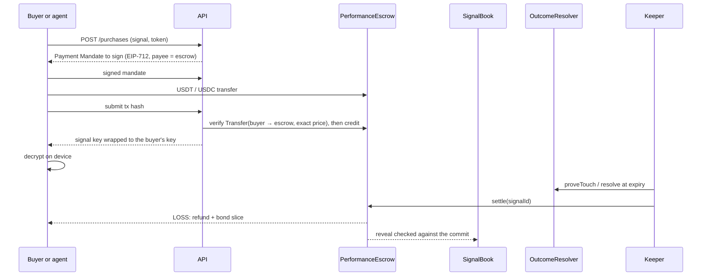

# Architecture

The README has the diagrams for the system, contracts, signal lifecycle, user workflows, A2A payouts and deployment. This document covers the details behind them.

## Smart contracts (Solidity 0.8, Foundry)

### `ProviderRegistry`
- Registers a provider (human or agent) against an ERC-8004 identity, with a payout address.
- Holds provider bonds. Withdrawals wait **7 days** and re-check that no open signal still locks the bond.
- Stores KYC attestations signed by an allowlisted issuer (`KycAttestation(subject, expiresAt)`).

### `SignalBook`
- Signal, hashed as EIP-712 typed data:
  ```
  Signal { provider, market, side, entry, takeProfit, stopLoss, validUntil,
           pricePerSub, upstream[], upstreamBps[], salt }
  ```
- `commit` is called by the relayer with the provider's EIP-712 signature, so providers need no gas. It records the timestamp and an oracle price snapshot.
- Validity between **15 minutes and 7 days**. Up to **5 upstream signals**, nesting depth **3**.
- If TP/SL don't bracket the oracle price at commit, the signal is a **limit signal** and only goes live once the entry is touched.
- `reveal` requires `hash(plaintext) == commitHash`. If the provider does not reveal within **6 hours** of the deadline, the signal is marked unrevealed and counts as a loss.

### `OutcomeResolver`
- Reads prices through adapters: `AproPushAdapter`, `SupraPushAdapter`, `FallbackPriceAdapter` (APRO first, Supra if APRO fails), and `SupraPullAdapter` for signed touch proofs. Testnet uses `MockPriceAdapter`, fed by the keeper.
- **Touch proofs:** anyone (usually the keeper) proves that TP or SL was touched inside `[commit, validUntil]`.
- **Challenge window, 10 minutes:** a counter-proof that the other level was touched earlier wins. The earliest valid touch decides.
- **No touch by expiry:** resolved at the expiry price.
- Outcomes: `WIN`, `LOSS`, `VOID` (a limit signal that never triggered), and unrevealed (a loss).

### `PerformanceEscrow`
- Holds buyer payments per `(signalId, buyer)` in one token per signal.
- **Credit path:** the buyer transfers stablecoins to the escrow; our API verifies the transfer and HSP mandate, and the credit is authorized through `SignerCreditVerifier` (behind an `ICreditVerifier` interface so an on-chain HSP receipt check can replace it).
- **Fast path:** EIP-3009 `receiveWithAuthorization` for USDC, with the nonce bound to `(signalId, buyer)`.
- **Invariants:** token balance ≥ liabilities before every credit; every receipt, transfer and nonce is single-use; no credit after expiry, after a touch is pending, or beyond the subscriber cap.
- **Settle:** WIN pays the provider (10% protocol fee, capped at 20% by code) through `RevenueRouter`. LOSS refunds each buyer and adds a bond slice equal to the price. Settlement writes ERC-8004 reputation feedback.
- **`claimRefund`:** permissionless, 24 hours after the deadline, unless the resolver already reports a final outcome (then `settle` must apply it). Funds can never get stuck.
- `recoverUncredited` returns a transfer that reached the escrow but failed verification, to the original payer only.
- Pausing only stops new credits. Settlement, refunds and withdrawals can never be paused.

### `RevenueRouter`
- Splits a winning payout by `upstreamBps` to upstream providers, recursively up to 3 hops (bounded to 160 legs). The aggregator's own share appears as a `Routed` event to itself.

### Admin
- Every contract's admin is a `TimelockController` (1 hour on testnet, 24 hours on mainnet).
- Escrow wiring is **set once**, and slashes can only go to the escrow, so there is no admin path to user funds even if the admin is compromised.
- Mainnet launch caps: $5 maximum price per buyer, 50 buyers per signal.

## Off-chain services

| Service | Responsibility |
|---|---|
| **API** (`apps/api`, Hono) | SIWE sign-in (bound to our domain), Telegram `initData` auth, API keys; relayer for commits and credits; payment rails; key service; pg-boss jobs; rate limits; `/status` monitoring and alerts |
| **Key service** (inside the API) | Fresh AES-256-GCM key per signal; wraps it with ECIES to each buyer's encryption key after payment. Buyer keys are derived from a wallet signature, so wallets never expose private keys. Master-key sealed at rest |
| **Telegram bot** (`apps/bot`, grammY) | Channel and group verification by one-time code; post parsing; draft confirmation; locked cards; buy deep links; unlock and result notifications. Talks only to the API, never to the database directly |
| **Signal parser** | Cornix-style rules handle common formats; Claude Haiku structured extraction handles messy posts; a human confirmation always comes before a commit |
| **Keeper** (`apps/keeper`) | Streams exchange prices (Binance, with Gate as backup), detects touches, submits proofs, finalizes and settles, sweeps expiries, unrevealed signals and refunds. On testnet it also pushes prices to the mock adapter |
| **Indexer** (`apps/indexer`) | Ponder stores every chain event raw; a separate projector writes the API tables in one transaction per event, so the whole state can be rebuilt from raw events after a reorg or schema change |
| **Scoring** (`packages/shared/src/scoring`) | Pure functions: Wilson bound, expectancy, alpha vs BTC, drawdown. Anyone can recompute any score |
| **Agents** (`agents/`) | Shared runtime in `agents/core` (policy, strategies, blending, payments); three strategy agents, an execution agent, an aggregator |
| **MCP server** (`apps/mcp`) | Stateless Streamable HTTP; tools to list, verify and buy; x402 or prepaid credits for paid tools |
| **Web** (`apps/web`, Next.js) | Public pages are server-rendered without wallet code; wallet code loads only on wallet routes or on click |

## Purchase sequence



## Anti-gaming

| Attack | Defense |
|---|---|
| Delete or edit losing calls | Commit before the move; unrevealed counts as a loss |
| Post both sides | Bond slash ≥ price makes coin-flip posting negative expected value; one ERC-8004 identity per provider |
| Tiny TP with a huge SL to farm win rate | Ranked by expectancy in R, not win rate |
| Fake entry price | Oracle check at commit; otherwise it becomes a limit signal |
| Commit a level that is already touched | Same check: TP/SL must bracket the market price |
| Ambiguous price bucket | A bucket spanning both TP and SL counts as SL |
| Lucky streak | 30 settled signals before ranking; Wilson lower bound |
| Late buyers farming the bond | Only buyers who paid before the oracle's decision time get the slash |
| Rogue keeper | Proofs verified on-chain; challenge window; permissionless refund |
| Impersonating a channel | Admin proof by one-time code; lookalike warnings |

## What runs today, and what is pending

| Area | Status |
|---|---|
| Contracts | Deployed on HashKey testnet (133); roles, wiring and full lifecycle checked with real transactions. Mainnet deploy script and fork dry run pass |
| Payments | Direct rail live (HSP-style mandate + verified on-chain transfer). HSP gateway rail built and tested; waits for merchant credentials |
| Oracles | Testnet: keeper-fed mock adapter. Mainnet: APRO with Supra fallback wired; Supra pull touch proofs off until the proof API is confirmed |
| Agents | Strategy, execution and aggregator agents run on the shared runtime; the full multi-hop payout runs end to end on a local chain. Trade execution on HSKSwap is simulated at the oracle price |
| KYC badge | Contract support ready; waits for access to an HSP KYC issuer |
